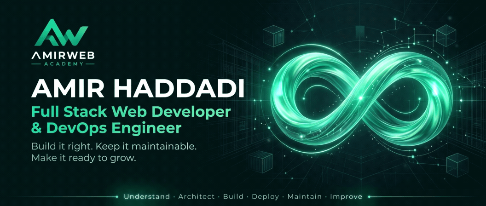
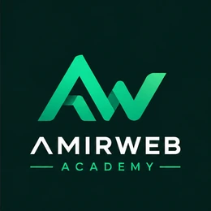

<b>فارسی</b> &nbsp;·&nbsp; <a href="./README.md">English</a>

  

<picture>
  <source media="(prefers-reduced-motion: reduce)" srcset="./assets/banner.jpg">
  
</picture>

  

 

## `01` &nbsp;درباره من

سامانه‌های تحت وب را از صفر تا صد طراحی، توسعه و اجرا می‌کنم؛ از اولین طرح معماری تا سروری که روی آن زندگی می‌کند.
بک‌اند‌محور، امنیت‌محور، و متمرکز بر نرم‌افزاری که در سال دومش هم به‌راحتی قابل تغییر باشد.

**الان** ← در حال ساخت **امیر وب آکادمی**؛ پلتفرمی که بقیهٔ پروژه‌ها را با آن تحویل می‌دهم.

## `02` &nbsp;پروژهٔ شاخص · امیر وب آکادمی

<table>
<tr>
<td width="150" align="center"></td>
<td>

**امیر وب آکادمی · دولوپ و دواپس** — کاکپیت مهندسی بومی و Local-First (‏Electron + Next.js + Prisma) که ایجنت‌های هوش مصنوعی، مخازن واقعی، ترمینال، دیتابیس و استقرار ابری را در یک‌جا جمع می‌کند.

`ترمینال WebGL ماندگار` `مادربرد پروژه‌ها` `ماتریس تسک AI` `کاکپیت گیت` `خزانهٔ اسنپ‌شات` `پل ابری PaaS`

بستهٔ بومی <code>.deb</code> + وب‌اپ مستقل · توکن‌های طراحی WCAG AAA · ساخته‌شده با خودش

</td>
</tr>
</table>

## `03` &nbsp;چه می‌سازم

| توسعهٔ محصول | زیرساخت و DevOps | امنیت و پایداری |
|:--|:--|:--|
| سامانه‌های اختصاصی تحت وب | استقرار روی Linux / VPS | JWT · Session · RBAC |
| SaaS و سامانه‌های چندمستأجره | CI/CD و فرایند انتشار | امنیت API و Rate Limiting |
| CRM، داشبورد و ابزارهای سازمانی | Docker و Nginx | استراتژی Backup و Rollback |
| فروشگاه و سامانه‌های داخلی | مانیتورینگ و نگهداری | بهینه‌سازی و مقیاس‌پذیری |
| اپلیکیشن دسکتاپ بومی (Electron) | Cloudflare و Edge | معماری ماژولار |

## `04` &nbsp;استک

  

## `05` &nbsp;مسیر تحویل

  

<code>نیازسنجی</code> ← <code>معماری</code> ← <code>توسعه</code> ← <code>استقرار</code> ← <code>نگهداری</code> ← <code>بهبود</code>

## `06` &nbsp;نمونه‌کارهای منتخب

| پروژه | حوزه | لینک |
|:--|:--|:--|
| **ستاد یار** | سازمانی · CRM · مالی | [app.setadyar.com](https://app.setadyar.com) |
| **آراکا** | پلتفرم تحت وب | [app.arakaco.com](https://app.arakaco.com) |
| **کارلی کالکشن** | فروشگاه اینترنتی | [karlycollection.com](https://karlycollection.com) |
| **آنلاین پیامک** | پیامک و پنل خدماتی | [onlinepayamak.com](https://onlinepayamak.com) |
| **زاگرس تک** | صنعتی · شرکتی | [techzagros.ir](https://techzagros.ir) |

## `07` &nbsp;متن‌باز

| مخزن | توضیح | استک |
|:--|:--|:--|
| [**storefront**](https://github.com/AmirHaddadi/storefront) | زیرساخت فروشگاهی فارسی‌محور و بدون فریم‌ورک | `Node.js` `Express 5` `MongoDB` |
| [**homa-bridge**](https://github.com/AmirHaddadi/homa-bridge) | پل MetaTrader 5 ↔ Python؛ تحلیل چندتایم‌فریم، آزمایشگاه استراتژی، بک‌تست و ژورنال معاملات | `Python` |
| [**LinPlayer**](https://github.com/AmirHaddadi/LinPlayer) | نسل جدید مدیا پلیر برای لینوکس | `TypeScript` |
| [**SP-Downloader**](https://github.com/AmirHaddadi/SP-Downloader) | دانلودر همه‌کاره برای بیش از ۲۵ سرویس ویدیویی | `JavaScript` |
| [**Simple-For-Students**](https://github.com/AmirHaddadi/Simple-For-Students) | قالب رایگان سایت با Node.js / Next.js برای دانشجویان | `TypeScript` |

## `08` &nbsp;فعالیت

<picture>
  <source media="(prefers-color-scheme: dark)" srcset="https://raw.githubusercontent.com/AmirHaddadi/AmirHaddadi/output/snake-dark.svg">
  <source media="(prefers-color-scheme: light)" srcset="https://raw.githubusercontent.com/AmirHaddadi/AmirHaddadi/output/snake-light.svg">
  
</picture>

 

**درست بسازیم؛ قابل نگهداری نگه داریم؛ آماده رشد تحویل بدهیم.**

<a href="mailto:hadaddi93@gmail.com">hadaddi93@gmail.com</a> &nbsp;·&nbsp; <a href="https://parscoders.com/resume/451182">پارس‌کدرز</a> &nbsp;·&nbsp; <a href="https://github.com/AmirHaddadi">@AmirHaddadi</a>

