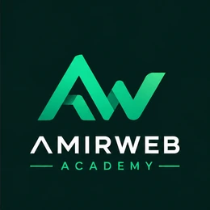

<a href="./README.fa.md">فارسی</a> &nbsp;·&nbsp; <b>English</b>

  

<picture>
  <source media="(prefers-reduced-motion: reduce)" srcset="./assets/banner.jpg">
  
</picture>

  

 

## `01` &nbsp;About

I design, build and run web platforms end to end — from the first architecture sketch to the server it lives on.
Backend-first, security-minded, and focused on software that is still easy to change in its second year.

**Now** → building **AmirWeb Academy**, the platform I use to ship everything else.

## `02` &nbsp;Flagship · AmirWeb Academy

<table>
<tr>
<td width="150" align="center"></td>
<td>

**AmirWeb Academy · Dev & DevOps** — a native, local-first engineering cockpit (Electron + Next.js + Prisma) that puts AI coding agents, real repositories, terminals, databases and cloud deploys in one place.

`persistent WebGL terminal` `project motherboard` `AI task matrix` `git pilot` `snapshot vault` `cloud PaaS bridge`

Native <code>.deb</code> + standalone web app · WCAG AAA design tokens · built with itself

</td>
</tr>
</table>

## `03` &nbsp;What I build

| Product engineering | Infrastructure & DevOps | Security & reliability |
|:--|:--|:--|
| Custom web platforms | Linux / VPS deployment | JWT · Session · RBAC |
| SaaS & multi-tenant systems | CI/CD & release pipelines | API security & rate limiting |
| CRM, dashboards & business tools | Docker & Nginx | Backup & rollback strategy |
| E-commerce & internal systems | Monitoring & maintenance | Performance & scalability |
| Native desktop apps (Electron) | Cloudflare & edge | Modular architecture |

## `04` &nbsp;Stack

  

## `05` &nbsp;How I ship

  

<code>understand</code> → <code>architect</code> → <code>build</code> → <code>deploy</code> → <code>maintain</code> → <code>improve</code>

## `06` &nbsp;Selected work

| Project | Domain | Live |
|:--|:--|:--|
| **SetadYar** | Enterprise · CRM · finance | [app.setadyar.com](https://app.setadyar.com) |
| **Araka** | Web platform | [app.arakaco.com](https://app.arakaco.com) |
| **Karly Collection** | E-commerce | [karlycollection.com](https://karlycollection.com) |
| **Online Payamak** | SMS & service panel | [onlinepayamak.com](https://onlinepayamak.com) |
| **Zagros Tech** | Industrial · corporate | [techzagros.ir](https://techzagros.ir) |

## `07` &nbsp;Open source

| Repository | What it is | Stack |
|:--|:--|:--|
| [**storefront**](https://github.com/AmirHaddadi/storefront) | Persian-first, framework-free e-commerce foundation | `Node.js` `Express 5` `MongoDB` |
| [**homa-bridge**](https://github.com/AmirHaddadi/homa-bridge) | MetaTrader 5 ↔ Python — multi-timeframe analysis, strategy lab, backtests, trade journal | `Python` |
| [**LinPlayer**](https://github.com/AmirHaddadi/LinPlayer) | Next-generation media player for Linux | `TypeScript` |
| [**SP-Downloader**](https://github.com/AmirHaddadi/SP-Downloader) | Universal media downloader for 25+ video services | `JavaScript` |
| [**Simple-For-Students**](https://github.com/AmirHaddadi/Simple-For-Students) | Free Node.js / Next.js website starter for students | `TypeScript` |

## `08` &nbsp;Activity

<picture>
  <source media="(prefers-color-scheme: dark)" srcset="https://raw.githubusercontent.com/AmirHaddadi/AmirHaddadi/output/snake-dark.svg">
  <source media="(prefers-color-scheme: light)" srcset="https://raw.githubusercontent.com/AmirHaddadi/AmirHaddadi/output/snake-light.svg">
  
</picture>

 

**Build it right. Keep it maintainable. Make it ready to grow.**

<a href="mailto:hadaddi93@gmail.com">hadaddi93@gmail.com</a> &nbsp;·&nbsp; <a href="https://parscoders.com/resume/451182">ParsCoders</a> &nbsp;·&nbsp; <a href="https://github.com/AmirHaddadi">@AmirHaddadi</a>

