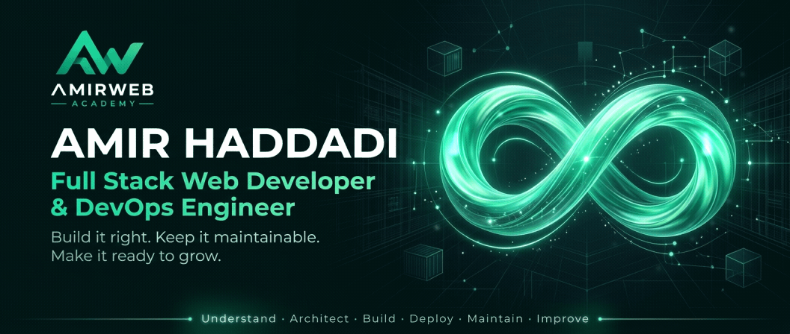

<picture>
  <source media="(prefers-reduced-motion: reduce)" srcset="./assets/banner.jpg">
  
</picture>

  

 

## `01` &nbsp;About

I design, build and run web platforms end to end — from the first architecture sketch to the server it lives on.
Backend-first, security-minded, and focused on software that is still easy to change in its second year.

I lead **AmirWeb Academy**, a small team covering development, DevOps, UI/UX design, SEO and content.

## `02` &nbsp;Work with us · [amirwebacademy.ir](https://amirwebacademy.ir)

<table>
<tr>
<td width="150" align="center"></td>
<td>

**[amirwebacademy.ir](https://amirwebacademy.ir)** is the front door to me and my team — one place to take your website or digital product from design to launch, then SEO and growth.

- **[Start a project](https://amirwebacademy.ir/start-project)** — describe it once; the request reaches the team instantly
- **Services** — development & DevOps · UI/UX design · technical SEO & growth · local search & maps · content & brand studio
- **[Blog](https://amirwebacademy.ir/blog)** — notes from real projects

Runs on <b>AmirWeb Academy · Dev & DevOps</b> — our own native, local-first cockpit (Electron + Next.js + Prisma) for repos, terminals, AI agents, backups and cloud deploys.

</td>
</tr>
</table>

## `03` &nbsp;Selected work

| Project | What it is | Stack | Live |
|:--|:--|:--|:--|
| **Cherry Café** | Café platform — online ordering, table booking and loyalty club, native admin, Android self-order kiosk with card reader and receipt printer, TV order queue | `Next.js 15` `PostgreSQL` `Electron` `Capacitor` | [cherryexperience.ir](https://cherryexperience.ir) |
| **B-Line Café** | Café ordering suite — web ordering and loyalty, desktop admin (`.deb` / `.exe`), portrait Android kiosk with POS payments and ESC/POS printing | `Next.js 15` `Prisma` `PostgreSQL` `Electron` | [blinecafe.ir](https://blinecafe.ir) |
| **Nesino** | Personal and business finance & accounting — web + Android, admin desktop console over an HMAC-signed API | `Next.js 16` `PostgreSQL` `Electron` | [nesino.ir](https://nesino.ir) |
| **SetadYar** | Sales & procurement assistant — contacts, official price proposals, reminders, stamped documents and tender tracking; offline-ready PWA | `Node.js` `Express` `MongoDB` | [app.setadyar.com](https://app.setadyar.com) |
| **Araka** | Construction marketplace — projects and contractor bids, materials market, machinery rental, live support chat, OTP login, push | `Express` `MongoDB` `Capacitor` `FCM` | [app.arakaco.com](https://app.arakaco.com) |
| **Karly Collection** | Women's fashion store — framework-free storefront, Telegram admin bot, SMS notifications | `Express` `MongoDB` | [karlycollection.com](https://karlycollection.com) |
| **Online Payamak** | SMS service website — pixel-perfect Figma build, RTL, light & dark themes | `HTML` `CSS` `jQuery` | [onlinepayamak.com](https://onlinepayamak.com) |

## `04` &nbsp;What I build

| Product engineering | Infrastructure & DevOps | Security & reliability |
|:--|:--|:--|
| Custom web platforms | Linux / VPS deployment | JWT · Session · RBAC |
| SaaS & multi-tenant systems | CI/CD & release pipelines | API security & rate limiting |
| CRM, dashboards & business tools | Docker & Nginx | Backup & rollback strategy |
| E-commerce, ordering & kiosk systems | Monitoring & maintenance | Performance & scalability |
| Native desktop & Android apps | Cloudflare & edge | Modular architecture |

## `05` &nbsp;Stack

  

## `06` &nbsp;How I ship

  

<code>understand</code> → <code>architect</code> → <code>build</code> → <code>deploy</code> → <code>maintain</code> → <code>improve</code>

## `07` &nbsp;Open source

| Repository | What it is | Stack |
|:--|:--|:--|
| [**storefront**](https://github.com/AmirHaddadi/storefront) | Persian-first, framework-free e-commerce foundation | `Node.js` `Express 5` `MongoDB` |
| [**homa-bridge**](https://github.com/AmirHaddadi/homa-bridge) | MetaTrader 5 ↔ Python — multi-timeframe analysis, strategy lab, backtests, trade journal | `Python` |
| [**LinPlayer**](https://github.com/AmirHaddadi/LinPlayer) | Next-generation media player for Linux | `TypeScript` |
| [**SP-Downloader**](https://github.com/AmirHaddadi/SP-Downloader) | Universal media downloader for 25+ video services | `JavaScript` |
| [**Simple-For-Students**](https://github.com/AmirHaddadi/Simple-For-Students) | Free Node.js / Next.js website starter for students | `TypeScript` |

## `08` &nbsp;Activity

<picture>
  <source media="(prefers-color-scheme: dark)" srcset="https://raw.githubusercontent.com/AmirHaddadi/AmirHaddadi/output/snake-dark.svg">
  <source media="(prefers-color-scheme: light)" srcset="https://raw.githubusercontent.com/AmirHaddadi/AmirHaddadi/output/snake-light.svg">
  
</picture>

 

**Build it right. Keep it maintainable. Make it ready to grow.**

<a href="https://amirwebacademy.ir/start-project"><b>Start a project on amirwebacademy.ir →</b></a>

<a href="mailto:hadaddi93@gmail.com">hadaddi93@gmail.com</a> &nbsp;·&nbsp; <a href="https://parscoders.com/resume/451182">ParsCoders</a> &nbsp;·&nbsp; <a href="https://github.com/AmirHaddadi">@AmirHaddadi</a>

